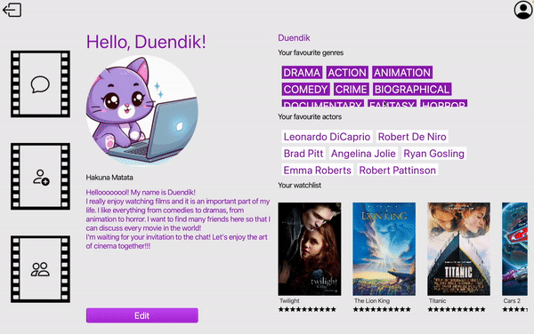
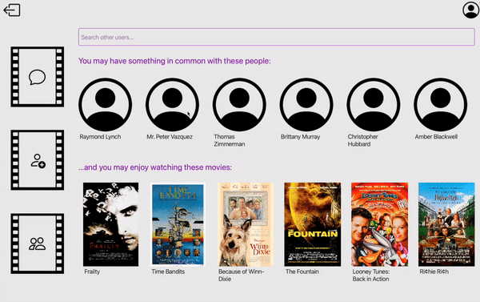
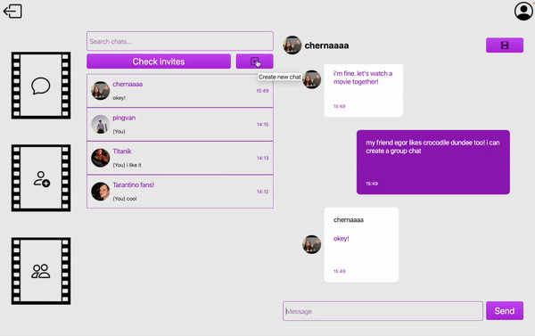
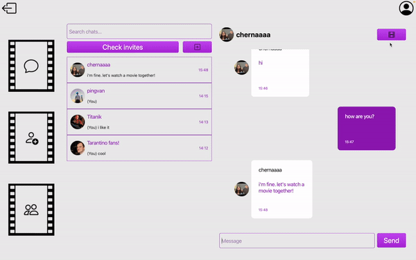
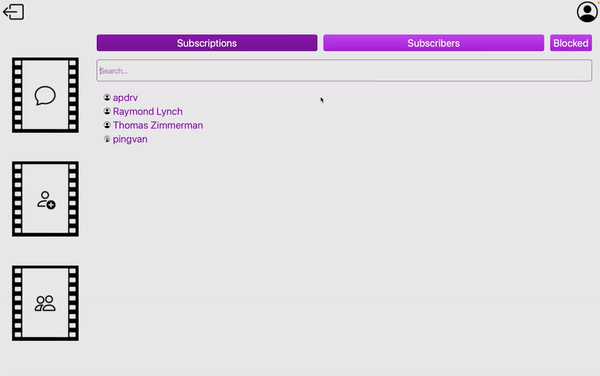

<div align="center">
    
    <h1>Duende</h1>
    <p>- an application where you can fill your watch and friends lists.</p>
    <a href="#special-thanks">Gratitude</a> •
    <a href="#about-project">About</a> •
    <a href="#why-duende">Features</a> •
    <a href="#look-at-the-preview">Preview</a> •
    <a href="#how-to-install-it">Installation</a> •
    <a href="#about-authors">Authors</a>
    <h2></h2>
</div>

Предпочитаете русский? Читайте: <a href="./README.ru.md">Русская версия</a>

<div align="center">
    
</div>

## Special thanks:

We would like to express our sincere gratitude to the mentor of our project, <a href="https://github.com/Vladislav0Art">Vladislav Artyukhov</a>. During development, we discovered a lot of new things not only within the assigned tasks, but also beyond them. The experience gained while working with Vlad, his contribution, valuable recommendations, regular online meetings to solve problems that arose along the way, helped us turn the idea into reality. His mentorship behind the scenes of our movie application was reminiscent of an experienced director helping his team achieve the best results.

We are extremely grateful to Vlad for his support, professionalism and commitment to excellence that made Duende possible.

## About project:

**Duende** (from Spanish - the ability of a piece of art to cut to the heart) is an application where movie lovers can chat about topics that interest them.

The user shares his preferences in cinema, based on which we recommend his interlocutors or films to watch. You can send invitations to the people you like for private correspondence (and even there we will generate a movie for you that will suit both of you!), as well as create group chats for large companies. By going to someone’s profile, you can see not only general information about the user, but also what genres he prefers, what actors he likes and how he responds to the films he has watched.

Duende is a platform for dating and communication, where there is always something to talk about!

<div align="center">
    
</div>


## Why Duende?

- **Recommendation service:** users and movies - for one or two people.
- **Chats:** private and group with different capabilities and privileges for members.
- **Interaction between users:** subscription, blocking, search services.
- **Detailed profiles:** favorite genres, actors, list of films watched with ratings, as well as information about yourself: bio, favorite quote, photo.
- **Other services:** services for authorization and invitations to private and group chats.

## Look at the preview:

You can watch the <a href="https://docs.google.com/presentation/d/1Ex-56XNowumhmJBxGufaQl8g7dLR2u_9ogB1gdCyv50/edit#slide=id.p4">presentation</a> (ru) of our project, as well as the <a href="https://youtu.be/vyidtRRDYiE">demonstration video</a> on YouTube.

<div align="center">
    <div>
        
        <p>Recommendations</p>
        <br>
    </div>
    <div>
        
        <p>Group chat creation</p>
        <br>
    </div>
    <div>
        
        <p>Film recommendation for private chat</p>
        <br>
    </div>
    <div>
        
        <p>Subscriptions</p>
        <br>
    </div>
</div>


## How to install it?

# Setting up gRPC for Server and Client

To set up both server and client, you need to install gRPC first. You can follow the [gRPC C++ Quickstart Guide](https://grpc.io/docs/languages/cpp/quickstart/) or follow the instructions below.

```bash
# Setting up gRPC Install Directory
export MY_INSTALL_DIR=$HOME/.local
mkdir -p $MY_INSTALL_DIR
export PATH="$MY_INSTALL_DIR/bin:$PATH"

# Installing CMake and gRPC Dependencies
sudo apt-get update   
sudo apt-get install -y cmake
sudo apt-get install -y build-essential autoconf libtool pkg-config
sudo apt-get install -y git

# Installing OpenSSL
sudo apt-get install -y openssl
sudo apt-get install -y libssl-dev

# Installing gRPC
git config --global http.postBuffer 524288000 # Changing buffer size to avoid cloning problems
git clone --recurse-submodules -b v1.64.0 --depth 1 --shallow-submodules https://github.com/grpc/grpc
cd grpc
mkdir -p cmake/build
cd cmake/build/
cmake -DgRPC_INSTALL=ON \
      -DgRPC_BUILD_TESTS=OFF \
      -DCMAKE_INSTALL_PREFIX=$MY_INSTALL_DIR \
      ../..
make -j 4
sudo make install
```

# Building server

```bash
# Installing GoogleTest
git clone https://github.com/google/googletest.git -b v1.14.0
cd googletest/
mkdir build
cd build
cmake ..
make
sudo make install

# Installing Libpq
sudo apt-get install -y libpq-dev

# Cloning Duende Repository
git clone https://github.com/pingvan/duende.git
git submodule update --init --recursive
cd duende/
mkdir -p build
cd build/
cmake ..
make
cd ../certs
bash generate_certs.sh
cd ..
bash export_env.sh
```

# Building client 

```bash
#Installing Qt-6
sudo apt-get install -y qt6-base-dev

#Inside duende dir
cd client
mkdir -p build
cd build
cmake ..
```

## About authors:

<p align="center">
 <b>Starring:</b><br>
 Albov Egor - <a href="https://github.com/pingvan">pingvan</a><br>
 Kolesova Sonya - <a href="https://github.com/kolesovasonya">kolesovasonya</a><br>
 Chernokulskaya Alina - <a href="https://github.com/chernaaaa">chernaaaa</a><br>
 <br>
 <b>Under the direction of:</b><br>
 Artyukhov Vladislav - <a href="https://github.com/Vladislav0Art">Vladislav0Art</a><br>
 <br>
 <b>Place and time of action:</b><br>
 National Research University Higher School of Economics<br>St. Petersburg<br>
 spring 2024
</p>